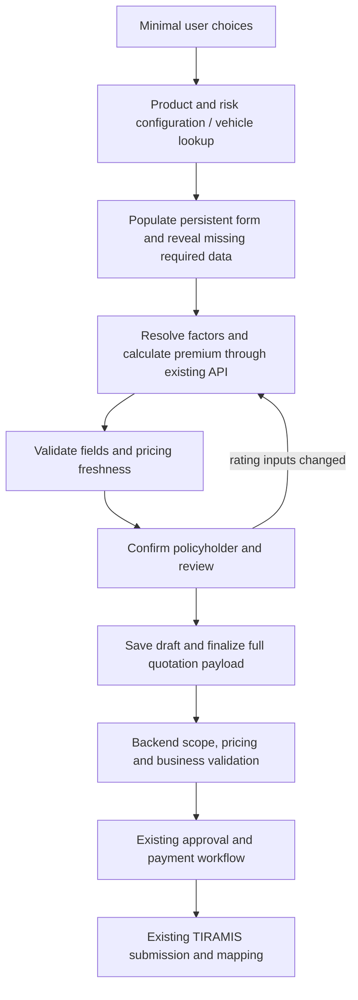

# Quotation wizard analysis and proposed redesign

Date: 2026-09-19. Status: proposal for approval; no application implementation changed.

This report describes the checked-in implementation, not a live TIRA certification or an audit of production product configuration. Recommendations preserve the existing quotation contracts, pricing authority, validation, approval, payment and submission workflow. Any field hidden from the screen must retain its value in form state, draft snapshots and the applicable submission payload.

## 1. Recommendation

| Flow         | Current journey                                                 | Proposed journey                                                                                      |
| ------------ | --------------------------------------------------------------- | ----------------------------------------------------------------------------------------------------- |
| Single Motor | Setup dialog + 3 steps                                          | 2 steps: Vehicle & Cover; Policyholder, Review & Create                                               |
| Motor Fleet  | Setup dialog + 4 steps; each vehicle has a 5-section sub-wizard | 3 steps: Fleet & Cover (including policyholder); Vehicles; Review & Create                            |
| Non-Motor    | Setup dialog + 3 steps                                          | 2 steps: Product & Risk; Policyholder, Review & Create; repeatable sections for multiple risks/assets |

Fold setup into the first step. Keeping the existing setup dialog as another mandatory form would undermine the reduction. A flow chooser can remain at the quotations entry point, without duplicating product, dates and distribution questions.

The final button should call the existing **finalize** operation. Use “Create Quotation” for new quotations and an appropriate completion label for edits. It must not silently submit to TIRA: approval, payment and TIRA submission are separate existing workflow actions.

## 2. Source map

Paths below are relative to the repository root. `web` means `apps/insurance-portal-web/src/modules/tenant/quotations`; `service` means `apps/insurance-portal-service/src/modules/tenant/quotations`.

| Concern                            | Principal sources reviewed                                                                                                                                                         |
| ---------------------------------- | ---------------------------------------------------------------------------------------------------------------------------------------------------------------------------------- |
| Actual routing and steps           | `apps/insurance-portal-web/src/App.tsx`; `web/pages/QuotationWizardPage.tsx`; `web/wizard/types.ts`; create/edit page redirects                                                    |
| Setup, cover and customers         | `web/wizard/QuotationStartModal.tsx`; `steps/CoverNoteSetupStep.tsx`, `FleetSetupStep.tsx`, `PolicyholderStep.tsx` under `web/wizard`; customer schemas; auth store                |
| Vehicle and fleet forms            | `web/wizard/steps/MotorDetailsStep.tsx`, `MotorFleetDetailsStep.tsx`; `components/VehicleLookup.tsx`; `utils/vehicleVerification.ts`, `fleetCsvImport.ts`                          |
| Risks, subjects and add-ons        | `web/wizard/steps/RiskPremiumStep.tsx`, `AddOnsStep.tsx`; `components/RiskRow.tsx`, `RiskTaxesFields.tsx`, `AddonRow.tsx`                                                          |
| State, contracts and serialization | `web/schemas.ts`, `types.ts`, `hooks.ts`, `api.ts`; `web/wizard/useQuotationWizardDraft.ts`                                                                                        |
| Pricing and derivation             | `web/wizard/hooks/useRiskPremiumCalculation.ts`, `useCoverNoteAutoText.ts`; `utils/riskFactorResolver.ts`, `pricingStaleness.ts`, `premiumAggregation.ts`; pricing API module      |
| Backend validation and lifecycle   | `service/quotations.controller.ts`, `quotations.service.ts`; `dto/quotation-payload.dto.ts`, `quotation-draft.dto.ts`; `services/quotation-payload.validator.ts`                   |
| Persistence and TIRAMIS mapping    | `service/entities/structured/quotation-cover-note-entry.entity.ts`; aggregate persistence in `quotations.service.ts`; `mappers/quotation-tiramis-payload.mapper.ts`                |
| Authoritative calculation          | `apps/insurance-portal-service/src/modules/tenant/premium-calculation/premium-calculation.service.ts`; pricing `application/pricing-engine.service.ts`, `pricing-quote.service.ts` |
| Verification                       | Frontend `modules/tenant/verifications/api.ts`; backend `modules/tenant/verifications/dto/verify.dto.ts`, `verifications.service.ts`                                               |

## 3. Current structure and visible fields

### Shared setup dialog

Quotation type/flow, insurance category, product, insurance channel, intermediary company when non-direct, currency, and date-range preset for Single Motor/Non-Motor. Category/product/currency/intermediary choices come from APIs. Selecting a date preset computes the dates. The dialog currently sets cover-note type to New.

The dialog is additional to the numbered steps. Fleet skips its date-range selection and uses the subsequent cover setup. New non-fleet cover setup has a compact branch; fleet and edit mode render the fuller setup form.

### Single Motor: three steps

1. **Customer & Cover:** start/end dates, foreign-currency exchange rate, cover description, operative clause, officer name/title, payment method; previous reference for renewal; endorsement type/reason/earned premium for endorsement; commission amount/rate for non-direct distribution. Policyholder existing/new selection and customer form are on this same step. Full setup in edit mode also exposes category/product/channel/currency/cover-note type/intermediary selection.
2. **Motor/Risk & Premium:** existing/new vehicle mode. Existing vehicles are filtered by selected customer and populate background fields, with a confirmation card. New mode provides lookup and the full vehicle form listed below. One or more risk rows expose risk selection, read-only risk code, sum insured, read-only equivalent, premium rate, before/after discount premium, equivalent premium, tax-inclusive premium, dynamic underwriting factors, discounts and taxes. Optional add-ons are embedded here.
3. **Review & Complete:** cover, customer, risk/premium, add-ons and vehicle summary, with edit links and completion action. Internal status is also displayed.

New vehicle fields: motor category, motor type, usage, registration, chassis, engine number, make, model, optional model number, body type, colour, year, seats, engine capacity, fuel, axles, axle distance, tare/gross weights, owner name/category/address. Lookup itself requests category, identifier type and identifier. Successful lookup populates fields but still leaves the long new-vehicle form visible.

### Motor Fleet: four steps, plus per-vehicle sub-wizard

1. **Customer & Cover / Fleet Header:** fleet ID, new/addition fleet type, read-only fleet size, manually entered comprehensive count, calculated fleet premium totals, and common cover setup. Despite the progress label, policyholder selection is in the following step.
2. **Policyholder:** existing customer or new policyholder form.
3. **Fleet risks:** vehicle list, add/duplicate/remove, CSV template/import, bulk premium calculation, row status and edit modal. Each vehicle modal has five sections: Vehicle Cover Note; Motor Details; Risk & Premium; Subject Matter & Add-ons; Review & Save Vehicle. The displayed section order differs from numeric IDs (`0,3,1,2,4`), while Back/Next advances numerically; navigation needs normalization.
4. **Review & Complete:** fleet/header/customer/vehicle summaries and completion.

Per-vehicle cover fields: entry number, description, operative clause, previous reference, conditional endorsement type/reason/earned premium. Risks repeat the code, sum insured/equivalent, rate, premium components, factors, discounts and taxes. Subjects request reference/description. Fleet add-ons use reference, description, insured amount and premium fields rather than the standard product-definition selector.

The fleet motor modal exposes category, type, registration, chassis, make/model/model number, body, colour, engine number/capacity, fuel, axles, seats, year and owner name/address. Its nested model also has **axle distance, tare weight, gross weight, motor usage and owner category**, required by the backend but missing from that visible manual field set. Lookup can populate them; a complete manual fallback needs to expose missing values.

CSV columns: registration, chassis, engine, make, model, body, colour, year, seats, owner name/address, risk code, sum insured, subject reference/description. The parser currently requires make, model, risk code, numeric sum insured and at least one vehicle identifier. Import does not itself run verification or produce every required motor field.

### Non-Motor: three steps

1. **Customer & Cover:** same common cover/customer form as Single Motor.
2. **Risk & Premium:** repeatable risk rows, dynamic factors fetched for the selected risk, subject-matter selection/reference/description and optional add-ons. Selecting a saved subject fills its reference and description; saved subjects are filtered by customer.
3. **Review & Complete:** cover/customer/risk/subject/add-on summary.

Dynamic factor rendering already exists. A rewrite should extend it rather than introduce one hardcoded form for every Non-Motor product.

### Shared policyholder fields

Existing mode selects a customer and shows a large read-only card: personal/company identity, contacts, identity documents/KYC and location. New mode requests customer type, full name, birth/incorporation date, individual gender, ID type/number, phone, country/region/district; email, fax, street and postal address are optional. Customer type changes constrain identity types and clear incompatible gender/ID selections.

The entire customer schema contains additional legacy/customer-management values, but those are not all visible wizard inputs and not all are transmitted in `PolicyHolderDto`.

## 4. Field classification and backend mapping

Classification describes the recommended ownership: **USER INPUT (Manual)**, **AUTO FETCH**, **AUTO POPULATE**, **AUTO CALCULATE**, **INTERNAL**, **OPTIONAL**. Multiple classifications indicate fallback or conditional behavior.

Payload notation: `I = internal_quotation`, `H = cover_note_hdr`, `D = cover_note_dtl`. For fleet common header fields use `D.fleet_hdr`; entry fields use `D.fleet_dtls[n]`. For standard flows they reside directly on `D`. `R` means an entry's `risks_covered[n]`, `A` its `cover_note_addons[n]`, `P` a header's `policy_holders[n]`, and `M` its `motor_dtl`.

### Setup, cover and internal context

| Frontend field(s)                                                                                                                          | Backend requirement/mapping                                                                            | Classification and visibility plan                                                                                                       |
| ------------------------------------------------------------------------------------------------------------------------------------------ | ------------------------------------------------------------------------------------------------------ | ---------------------------------------------------------------------------------------------------------------------------------------- |
| `quotation_flow`                                                                                                                           | `I.quotation_flow`, required enum                                                                      | USER INPUT once at entry; retain internally                                                                                              |
| `quotation_type`, `is_fleet`                                                                                                               | Required consistent type/flow/flag                                                                     | AUTO POPULATE from flow; hidden                                                                                                          |
| `category_id`                                                                                                                              | Required UUID, product scope validated                                                                 | AUTO POPULATE from chosen product; category may remain an optional search filter                                                         |
| `product_id`                                                                                                                               | Required UUID, active/allowed product and version checks                                               | USER INPUT from AUTO FETCH choices; auto-select only one valid choice                                                                    |
| Product/TIRAMIS code                                                                                                                       | Header `product_code`, required                                                                        | AUTO FETCH / INTERNAL; keep existing configured mapping; no ID fallback presented as a business code                                     |
| `channel_type`                                                                                                                             | Required enum; distribution validation                                                                 | USER INPUT unless authenticated/distribution context establishes it; show readable labels                                                |
| `intermediary_company_id`                                                                                                                  | Optional UUID in DTO, constrained by channel/product                                                   | Conditional USER INPUT from allowed companies; never silently change a non-direct sale to direct                                         |
| `insurer_company_id`                                                                                                                       | Required UUID, tenant scope                                                                            | AUTO POPULATE / INTERNAL from company context                                                                                            |
| `branch_id`, sales-point context                                                                                                           | Server resolves active branch/default sales point                                                      | AUTO FETCH / INTERNAL; configuration error if missing                                                                                    |
| `department_id`, `sub_class_id`                                                                                                            | Optional UUIDs                                                                                         | INTERNAL; retain existing edit values and supported context                                                                              |
| `valid_from`                                                                                                                               | Header `cover_note_start_date`, required datetime                                                      | USER INPUT with current-date default for new business; preserve edits/renewals                                                           |
| Date range / `valid_until`                                                                                                                 | Header `cover_note_end_date`, required and later than start                                            | USER INPUT for duration where choice exists; AUTO CALCULATE end; show period summary and allowed adjustment                              |
| `currency`                                                                                                                                 | Header `currency_code`, three uppercase letters                                                        | AUTO POPULATE TZS default; OPTIONAL choice where supported                                                                               |
| `exchange_rate`                                                                                                                            | Positive header rate; authoritative snapshot checks                                                    | AUTO POPULATE 1 for TZS; AUTO FETCH where supported; conditional USER INPUT for foreign currency until a reliable applicable rate exists |
| `cover_note_type`                                                                                                                          | `H.cover_note_type`, positive integer; UI new/renew/endorse                                            | AUTO POPULATE from workflow; preserve existing edit value                                                                                |
| `prev_cover_note_reference`                                                                                                                | `prev_cover_note_reference_number`                                                                     | AUTO FETCH from originating policy when available; conditional USER INPUT for renewal/endorsement                                        |
| `endorsement_type`, `endorsement_reason`, `endorsement_premium_earned`                                                                     | Entry fields; type/reason/reference dependencies, nonnegative amount                                   | Conditional USER INPUT / AUTO FETCH from transaction flow; retain all existing cases                                                     |
| `cover_note_desc`, `operative_clause`                                                                                                      | Required entry text, up to 500 characters                                                              | AUTO POPULATE using existing generation; collapse under editable cover wording; preserve custom wording                                  |
| `officer_name`, `officer_title`                                                                                                            | Required header text                                                                                   | AUTO POPULATE from staff profile; hidden when complete; targeted correction if missing                                                   |
| `payment_mode_tira`                                                                                                                        | Header `payment_mode`, also a rating factor                                                            | Default currently Cash; retain a readable conditional Payment method control unless context determines it; code INTERNAL                 |
| `commission_paid`, `commission_rate`                                                                                                       | Header uses existing `commision_paid`, `commision_rate` spelling; rate <= 1, amount bounded by premium | AUTO POPULATE zero for DIRECT; retain conditional non-direct controls until authoritative commission source is connected                 |
| `cover_note_number`, quotation number/IDs                                                                                                  | Generated/reused server-side identifiers                                                               | INTERNAL; not a user input                                                                                                               |
| `status`, rejection/status metadata, timestamps, rating version                                                                            | Server workflow/audit state                                                                            | INTERNAL; customer-facing workflow status may be a badge, not an input                                                                   |
| `sum_insured`, `basic_premium`, `total_discount`, `total_tax`, `total_charges`, `total_commission`, `total_premium`, `net_premium` at root | Aggregation/serialization helpers, not all direct DTO fields                                           | AUTO CALCULATE; summary only; never request duplicate entry                                                                              |

### Policyholder

| Frontend field(s)                                                                                                  | Backend mapping and constraints                                                              | Classification and visibility plan                                                                       |
| ------------------------------------------------------------------------------------------------------------------ | -------------------------------------------------------------------------------------------- | -------------------------------------------------------------------------------------------------------- |
| `policyholder_mode`, `customer_id`                                                                                 | Draft state/customer lookup; final payload contains a policyholder snapshot, not this mode   | USER INPUT when no confirmed match; AUTO FETCH customer record                                           |
| `customer_type`                                                                                                    | `P.policy_holder_type`; individual/corporate behavior                                        | USER INPUT or AUTO FETCH; numeric code INTERNAL                                                          |
| `full_name`, legacy first/middle/last/company names                                                                | `P.policy_holder_name`, max 200; customer schema has tighter name limits                     | AUTO FETCH or USER INPUT once; avoid duplicate name entry                                                |
| `date_of_birth`                                                                                                    | `P.policy_holder_birth_date`, date; birth/incorporation semantics                            | AUTO FETCH or USER INPUT; do not infer from vehicle owner name                                           |
| `gender`                                                                                                           | Required for individual; null for corporate                                                  | AUTO FETCH / conditional USER INPUT                                                                      |
| `id_type`, `id_number`                                                                                             | `P.policy_holder_id_type`, `policy_holder_id_number`; type restricted by customer category   | AUTO FETCH / USER INPUT; readable type selector, no raw codes                                            |
| `phone`                                                                                                            | `P.policy_holder_phone_number`; 9–15 digits, optional leading +                              | AUTO FETCH / USER INPUT                                                                                  |
| `country`, `country_code`                                                                                          | Country label is UI context; `P.country_code` is three-letter uppercase                      | AUTO POPULATE configured/default country; editable country choice; code hidden                           |
| `region`, `district`                                                                                               | `P.region`, `P.district`, required contract strings                                          | AUTO FETCH or dependent USER INPUT selectors; do not parse freeform owner address into asserted location |
| `street`, `postal_address`, `email`, `fax`                                                                         | Optional `P.street`, `postal_address`, `email_address`, `policy_holder_fax`; email validated | OPTIONAL, collapsed contact/address details                                                              |
| Customer number, KYC/document/contact-person/alternate-phone/ward/nationality and other customer-management fields | Existing customer card/schema data; not separate fields in quotation PolicyHolder DTO        | AUTO FETCH / INTERNAL or optional customer-record detail; avoid duplicating customer maintenance         |

Authenticated staff identity is not insured-customer identity. Current auth context supplies officer/branch data and does not establish a customer link for this wizard. Use a confirmed customer relationship if available; otherwise keep customer selection. Verified vehicle owner name/address can be offered for confirmation but cannot supply ID, date of birth, phone or legal identity.

### Vehicle: complete motor contract

All rows apply to Single Motor `motor.*`; fleet uses matching backend names under `fleet.items[n].motor_dtl.*`. Required below includes cross-field service validation, not just DTO decorators.

| Single Motor field                        | Backend field                                                                 | Classification and handling                                                                                  |
| ----------------------------------------- | ----------------------------------------------------------------------------- | ------------------------------------------------------------------------------------------------------------ |
| `vehicle_id`, `motor_mode`                | Lookup/draft context; final motor snapshot                                    | AUTO FETCH / INTERNAL after vehicle choice                                                                   |
| `registration_no`                         | `M.registration_number`, required, uppercase 3–50 letters/digits/hyphens      | USER INPUT for lookup OR AUTO FETCH; reveal missing/invalid value                                            |
| `chassis_no`                              | `M.chassis_number`, required, uppercase 6–100 letters/digits/hyphens          | USER INPUT for lookup OR AUTO FETCH; reveal missing/invalid value                                            |
| `motor_category_code`, `vehicle_category` | `M.motor_category`; label is a UI alias                                       | AUTO FETCH or conditional USER INPUT (vehicle/motorcycle); lookup itself requires category                   |
| `motor_type_code`                         | `M.motor_type`, positive integer                                              | AUTO FETCH or conditional USER INPUT; do not assume a type solely from cover                                 |
| `motor_usage_code`, `usage_type`          | `M.motor_usage`; rating resolver maps usage values                            | AUTO FETCH / USER INPUT if missing or usage requires confirmation; human labels                              |
| `engine_no`                               | `M.engine_number`, required, uppercase 3–100 letters/digits/hyphens           | AUTO FETCH; manual fallback                                                                                  |
| `make`, `model`                           | Required `M.make`, `M.model`, normalized uppercase                            | AUTO FETCH; confirmation card; manual fallback                                                               |
| `model_no`                                | Optional `M.model_number`                                                     | AUTO FETCH / OPTIONAL in expanded details                                                                    |
| `body_type`, `color`                      | Required `M.body_type`, `M.color`                                             | AUTO FETCH; manual fallback                                                                                  |
| `manufacture_year`                        | `M.year_of_manufacture`, >=1886, service rejects beyond next UTC year         | AUTO FETCH; confirmation card; manual fallback                                                               |
| `seating_capacity`                        | `M.sitting_capacity`, integer >=1                                             | AUTO FETCH; reveal if missing or cover requires confirmation                                                 |
| `cubic_capacity`                          | `M.engine_capacity`, string representing a positive number                    | AUTO FETCH; manual fallback                                                                                  |
| `fuel_type`                               | Required `M.fuel_used`                                                        | AUTO FETCH; manual fallback                                                                                  |
| `number_of_axles`                         | `M.number_of_axles`, integer >=1                                              | AUTO FETCH; manual fallback                                                                                  |
| `axle_distance`                           | `M.axle_distance`, positive                                                   | AUTO FETCH; manual fallback; cannot replace missing value with zero                                          |
| `tare_weight`, `gross_weight`             | Positive `M.tare_weight`, `M.gross_weight`; gross >= tare                     | AUTO FETCH; manual fallback                                                                                  |
| `tonnage`                                 | Rating factor helper, not a separate MotorDetail DTO property                 | AUTO CALCULATE from validated weight where units match; USER INPUT only for distinct requested cargo measure |
| `owner_name`, `owner_address`             | Required `M.owner_name`, `M.owner_address`                                    | AUTO FETCH; owner confirmation/fallback; not proof of policyholder identity                                  |
| `owner_category`                          | `M.owner_category`, positive integer                                          | AUTO FETCH / conditional USER INPUT; label-to-code mapping retained                                          |
| `vehicle_value`                           | Existing vehicle metadata/form context, not separate MotorDetail DTO property | AUTO FETCH as suggested value only; do not silently equate historic vehicle value with current sum insured   |

Lookup accepts registration **or** chassis; final quotation currently requires **both**. A partial result is not sufficient to hide missing required fields. Motor category cannot disappear from lookup unless product/vehicle context determines it reliably. Preserve the existing manual path and make it complete for fleet.

### Risks, taxes, discounts and add-ons

| Field(s)                                                                                                         | Backend requirement/mapping                                                                     | Classification and visibility plan                                                                                                                          |
| ---------------------------------------------------------------------------------------------------------------- | ----------------------------------------------------------------------------------------------- | ----------------------------------------------------------------------------------------------------------------------------------------------------------- |
| `risk_id`, `risk_code`                                                                                           | Risk ID drives pricing APIs; required `R.risk_code` drives quotation contract                   | USER INPUT via cover name; AUTO FETCH code; hide code and UUID                                                                                              |
| `sum_insured`                                                                                                    | Nonnegative money `R.sum_insured`; pricing configuration may require positive value             | Conditional USER INPUT when selected risk needs it; retain supported explicit values on edits                                                               |
| `sum_insured_equivalent`                                                                                         | Required nonnegative money on R                                                                 | AUTO CALCULATE / INTERNAL. Existing serializers copy sum insured; preserve authoritative currency semantics rather than invent conversion                   |
| `factor_values`                                                                                                  | Required-factor metadata validates pricing request; not directly serialized into RiskCoveredDto | USER INPUT only for unresolved factors. AUTO POPULATE vehicle/header/customer factors; retain pricing snapshot linkage                                      |
| `premium_rate`                                                                                                   | Required rate on R, 0–1 business constraint                                                     | AUTO CALCULATE; hidden input; remove ordinary manual editing                                                                                                |
| `premium_before_discount`, `premium_after_discount`, `premium_excluding_tax_equivalent`, `premium_including_tax` | Required nonnegative money; financial reconciliation                                            | AUTO CALCULATE; display concise premium/tax/total summary                                                                                                   |
| `rate`, `basic_premium`, `total_premium`, minimum and legacy row totals                                          | Form compatibility/preview helpers                                                              | AUTO CALCULATE / INTERNAL; preserve serializers during migration                                                                                            |
| `rating_result_metadata`, `pricing_quote_id`, `client_ref`                                                       | Pricing identity, freshness, approval controls, signatures and batch matching                   | INTERNAL; preserve in state/drafts and send pricing quote ID through current serializer                                                                     |
| Discount type and requested rate                                                                                 | `R.discounts_offered[].discount_type`, `discount_rate`                                          | OPTIONAL USER INPUT under Adjustments, with existing permissions                                                                                            |
| Discount amount                                                                                                  | `discount_amount`                                                                               | AUTO CALCULATE; backend authority                                                                                                                           |
| Discount reason/comment and effective dates                                                                      | Optional request metadata; approval/business constraints may make them necessary                | Conditional USER INPUT / AUTO POPULATE                                                                                                                      |
| Requested/approved user/time, limits, approval flag/status, approved rate/amount, rejection reason               | Discount audit/approval fields                                                                  | INTERNAL; preserve server-owned decisions; status can be read-only                                                                                          |
| Tax code selection                                                                                               | `R.taxes_charged[].tax_code`                                                                    | AUTO FETCH choices, but currently USER INPUT for applicability. Show readable tax choice in conditional charges settings until deterministic defaults exist |
| Tax rate/amount                                                                                                  | Required numeric `tax_rate`, `tax_amount`                                                       | AUTO FETCH / AUTO CALCULATE; hide as inputs                                                                                                                 |
| Exempt flag/type/reference                                                                                       | `is_tax_exempted` maps boolean to Y/N; exemption requires type/reference and zero amount        | OPTIONAL USER INPUT; reveal supporting fields only when exempt; preserve real exemptions                                                                    |
| Add-on enabled/definition                                                                                        | UI selection; `A.addon_reference`/description from definition                                   | OPTIONAL USER INPUT from product catalog; IDs/references INTERNAL                                                                                           |
| Add-on description                                                                                               | Required `A.addon_desc` string                                                                  | AUTO FETCH default; retain optional custom description where allowed                                                                                        |
| Add-on insured amount/quantity                                                                                   | `A.addon_amount`; quantity feeds pricing                                                        | Conditional USER INPUT based on definition; not all add-ons need both                                                                                       |
| Add-on premium rate, excluding/equivalent/including-tax premium                                                  | Required A numeric values                                                                       | AUTO CALCULATE using configured pricing; no arbitrary amounts                                                                                               |
| Add-on taxes                                                                                                     | `A.taxes_charged[]`                                                                             | Same rate/amount/exemption ownership as risk taxes; retain all rows                                                                                         |

Important: an explicit empty `tax_codes` array currently means **no selected taxes**, whereas omission lets the pricing engine select defaults. Removing the tax UI and continuing to send an empty array changes neither this behavior nor the need for applicability data. Auto-selecting every active tax is also not equivalent to current user choices. Hide rates now; automate applicability only from verified applicable configuration, preserving historical/exempt selections.

Authorized premium changes must continue through the existing premium-override workflow. Removing generic premium number inputs must not remove that business capability.

### Fleet and Non-Motor subjects

| Field(s)                                                                     | Backend requirement/mapping                                                      | Classification and visibility plan                                                                                                                                         |
| ---------------------------------------------------------------------------- | -------------------------------------------------------------------------------- | -------------------------------------------------------------------------------------------------------------------------------------------------------------------------- | --- | --------------------------------------------------------------------------- |
| `fleet.header.fleet_id`                                                      | `D.fleet_hdr.fleet_id`, string                                                   | USER INPUT / AUTO FETCH for existing fleet; no generator for this field established by inspected quotation identifier method. Keep until a reliable generator/link is used |
| `fleet_type`                                                                 | Header positive integer; UI New Fleet/Fleet Addition                             | USER INPUT or AUTO POPULATE from transaction context                                                                                                                       |
| `fleet_size`                                                                 | Must equal detail count                                                          | AUTO CALCULATE / INTERNAL; summary count only                                                                                                                              |
| `comprehensive_insured`                                                      | Nonnegative and <= fleet size                                                    | AUTO CALCULATE only with reliable cover classification; otherwise retain confirmation input. Current serializer's `value                                                   |     | fleetItems.length` replaces valid zero with fleet size and needs correction |
| `fleet_no`, `fleet_name`, `fleet_item_id`, duplicate root vehicle properties | Legacy/draft identity/compatibility fields                                       | INTERNAL; use nested `motor_dtl` as canonical vehicle snapshot and migrate existing drafts safely                                                                          |
| `fleet_entry`                                                                | Unique contiguous integers 1..N                                                  | AUTO CALCULATE / INTERNAL on add/remove/duplicate/import; no input                                                                                                         |
| Per-vehicle description/clause                                               | Required entry strings                                                           | AUTO POPULATE common wording; keep optional per-vehicle override                                                                                                           |
| Per-vehicle previous reference/endorsement data                              | Same entry-level conditional rules                                               | AUTO FETCH or conditional USER INPUT; not a generic repeated questionnaire                                                                                                 |
| Motor subject reference/description                                          | Entry `subject_matters_covered[]`, at least one                                  | AUTO POPULATE registration/chassis + make/model (already done for Single Motor); retain custom additional subjects                                                         |
| Non-Motor saved subject selection                                            | Populates reference and description                                              | OPTIONAL AUTO FETCH from selected customer's assets                                                                                                                        |
| Non-Motor subject reference/description                                      | Required entry subjects; nonempty description and frontend reference requirement | USER INPUT when no saved subject; use meaningful asset reference, not fabricated insurance data                                                                            |
| Non-Motor product-specific factors                                           | Pricing metadata determines types/options/requirements                           | Conditional USER INPUT; AUTO POPULATE from saved asset only when a mapped field exists                                                                                     |

## 5. Dependencies and problems identified

1. **Repeated setup and technical clutter.** Setup dialog duplicates context later shown/edited in cover setup. Risk codes, equivalent amounts and editable calculated premiums consume space. Generated cover wording and profile officer values still occupy the normal form.
2. **Vehicle-first changes affect customer dependencies.** Existing vehicles and Non-Motor subjects are customer-filtered. Moving policyholder to step 2 requires an optional “Use a saved vehicle/asset” customer lookup in step 1, with the chosen customer carried forward; do not broaden access to other customers' assets.
3. **Pricing needs policyholder context.** The factor resolver includes policyholder type, sales point, officer, currency and payment method. A step-1 premium is provisional until step-2 customer context is resolved. Recalculate before final review and submission if it changes.
4. **Calculation is tied to mounted visual rows.** `useRiskPremiumCalculation` lives inside `RiskRow`; leaving that step unmounts it. Move orchestration to persistent wizard state so policyholder changes on review can trigger pricing. Preserve debouncing, stale-response protection and pricing signatures.
5. **Risk changes can clear vehicle facts.** The risk-switch effect clears mapped motor fields when outgoing factors are absent from the new risk. This can erase required verification data. Retain physical vehicle facts independently of risk-specific factor answers.
6. **Incomplete draft persistence.** React Hook Form retains values during Back/Next, and edit hydration merges stored snapshots. However, `useQuotationWizardDraft` is not wired into the page. `saveDraftSnapshot` is called only when completion first needs a draft; navigation is not autosaved. Add deliberate persistence using existing draft APIs, with concurrency/version handling. Do not promise refresh recovery today.
7. **Step validation reaches future fleet data.** `STEP_FIELDS['fleet-setup']` includes the entire `fleet` object, so next-step validation can inspect vehicle details before vehicle entry. Global schema also validates root `risks` for fleet even though fleet submits nested risks. Scope step checks correctly while retaining full final validation.
8. **Frontend/manual fleet validation is weaker than backend.** Vehicle issue summaries accept either identifier and omit several required motor properties. Reveal and validate actual missing fields before submission; retain backend validation.
9. **Bulk workflow remains manual-heavy.** CSV requires make/model/risk code/sum insured before lookup and leaves other mandatory fields unresolved. Keep compatibility with that format while adding identifier-first import with common cover defaults, bounded lookup concurrency, row retry and persistent row errors.
10. **Fleet totals differ between display and final authority.** Fleet setup, summary and serializer sum risk premiums while backend authoritative aggregation includes add-ons. Standard root aggregates also focus on risks. Use a shared customer-facing total projection including enabled add-ons, reconciled with existing backend output.
11. **Fleet numbering and duplication require care.** Duplication inserts an entry without renumbering all later entries and carries source pricing metadata. Reindex and invalidate/recalculate duplicated vehicle pricing without losing genuine shared cover values.
12. **Defaults are not uniformly safe.** Page defaults contain fixed 2026-07-21/2027-07-20 dates. Non-fleet setup normally replaces them; fleet skips that date preset. Generate new-business defaults at creation time and preserve saved dates. Do not blanket-apply non-fleet date restrictions to fleet/edits.
13. **Tax and add-on logic is duplicated.** Risk taxes use active taxes; standard add-ons filter tax rules; fleet add-ons have a separate form. Consolidate source resolution/calculation without dropping existing values or exemptions.
14. **Pricing review needs explicit readiness.** Some previews populate minimum premium before a final calculation. Numbers alone do not prove a valid, current pricing quote. Show calculating/failed/stale states and gate creation on complete current results.
15. **Source-level pricing integration concerns need targeted verification.** The inspected automatic calculation call supplies effective date but not cover start/end although the engine requires both for prorated rate books. Fleet save recalculation reads policyholder from standard `policy_holders` rather than `fleet_hdr.policy_holders`. Verify/fix these narrowly if tests confirm an affected configuration; do not redesign pricing rules.
16. **Partial lookup merges can retain stale values.** Lookup merges returned fields over the current vehicle. Switching to another vehicle with an incomplete response can leave old required data in place. Track vehicle identity/provenance and clear obsolete values before merging a replacement; retain deliberate same-vehicle corrections.

These are code observations and regression risks, not claims that every production quotation currently fails.

## 6. Proposed user experience

### Single Motor

**Step 1 — Vehicle & Cover**

- Registration or chassis lookup; derive category where reliable, otherwise a short vehicle/motorcycle choice. Preserve saved-vehicle selection via optional customer lookup.
- A compact result card: registration, make/model, year, vehicle category/type and owner when present. Expand only missing/invalid required facts or requested corrections.
- Product, cover/risk, start date and supported duration. Show sum insured only when relevant; preserve multiple risks and optional covers.
- Reveal only unresolved required factors. Charges, exemptions, discounts, custom wording, non-direct distribution and foreign-currency details use conditional sections.
- A concise premium preview with calculation state; technical rates/components remain in state.

**Step 2 — Policyholder, Review & Create**

- Confirm carried-forward customer or select/create one. Fill confirmed saved data; request only missing required information. Preserve edit permissions and the existing customer workflow.
- Recalculate after rating-relevant customer/context changes, then show vehicle, product/cover, sum insured where applicable, period, policyholder, premium, taxes/levies, optional covers and total.
- Field-level errors open the appropriate section, including hidden missing-data sections. Create calls draft/finalize APIs and navigates to existing quotation detail/workflow.

### Motor Fleet

**Step 1 — Fleet & Cover:** policyholder, product/common cover, dates, fleet new/addition context; fleet identity and comprehensive count only where not safely derived. Put uncommon distribution/wording/currency options behind conditional controls.

**Step 2 — Vehicles:** identifier-first rows or CSV, common cover defaults with explicit per-vehicle overrides, automatic verification and batch pricing. Each row shows vehicle, cover, insured amount, premium and readiness/error. A single expandable vehicle editor replaces five required mini-steps; preserve multiple risks, subjects, add-ons and endorsements. An import summary distinguishes rejected, unresolved and ready rows. Retry failed lookups/calculations without redoing successful rows.

**Step 3 — Review & Create:** fleet/customer/cover summary, vehicle count, totals including add-ons and taxes, unresolved row links, existing finalize action.

### Non-Motor

**Step 1 — Product & Risk:** product, selected risk(s), configured factors, applicable sum insured/base, cover period and insured subject(s). Use current required-factor metadata and `RatingFactorFields`; do not invent a new product schema or infer asset data from free text. Saved-asset selection may request customer early and carry that selection forward.

**Step 2 — Policyholder, Review & Create:** only missing customer data, updated pricing and full summary. Complex products can use repeatable/collapsible asset groups within step 1. Introduce another main step only if actual configured product requirements demonstrate the need.

### Defaults and state rules

- Auto-select sole valid options only after the option query succeeds; never use a temporary empty/loading result as proof that a field is irrelevant.
- Keep TZS/1 and configured country defaults; do not replace foreign-currency or saved-country values.
- Keep physical asset/customer facts separate from product/risk-specific answers. Changing product clears incompatible selections and pricing, not verified identity facts.
- Preserve custom wording, exemptions, discount requests and transaction data when navigating or hydrating edits.
- Keep one persistent form owner, stable row identities and calculation state across Back/Next. Migrate old step IDs and draft shapes explicitly.
- Responsive single-column sections on small screens, keyboard-accessible controls, compact summaries, inline lookup/pricing feedback and disabled creation while required work is unresolved.

## 7. Data flow, premium authority and compatibility

Existing endpoints remain the integration boundary:

- `POST /verifications/motor`: required motor category and at least one identifier. Pending/not-found/failed results remain distinct; acknowledgement alone is not a vehicle record.
- `POST /premium-calculation/single` and `/multi`: selected risk, resolved factors, currency/effective date, adjustments/taxes and applicable options. Multi-risk results support per-item failures.
- `POST /tenant/quotations/drafts`, `PUT /tenant/quotations/:id/draft`: incomplete snapshots and current step. Category/product/context are still required; draft does not mean fully validated quotation.
- `GET /tenant/quotations/:id/edit`: hydrate full saved state; preserve supported editable statuses.
- `POST /tenant/quotations/:id/finalize`: complete structured payload plus optimistic concurrency timestamp. Existing service replaces the aggregate, checks pricing freshness, evaluates requirements and clears draft state.
- Existing replace, preview, approval, payment, submit and retry endpoints remain unchanged. Actual TIRA submission rebuilds the authoritative payload and performs readiness/payment checks.

Pricing must remain server-authoritative: active risk/configuration and factors -> matching effective rule -> base premium/minimum/maximum -> optional covers -> applicable proration -> loadings -> discounts -> configured taxes/levies/fees -> rounding and stored pricing snapshot. The UI should project results rather than duplicate this engine. The motor save path refreshes pricing; Non-Motor does not use that same motor refresh path and relies on its valid pricing linkage. Do not assume finalization repairs every incomplete preview.

Persistence stores a quotation aggregate with cover-note header, entries, policyholder snapshots, motor/subject details, risks, discounts, taxes and add-ons. Hiding an input does not remove its entity field. Existing TIRAMIS mapper translates this validated structure into `motorDetail`, `fleet.items`, `risks`, `subjectMatters`, `addons`, `policyHolders` and their camel-case fields. Keep date formatting, numeric precision, null handling and integration codes intact.

| Compatibility area    | Proposed guarantee / verification needed                                                                                  |
| --------------------- | ------------------------------------------------------------------------------------------------------------------------- |
| Backend APIs and DTOs | Retain existing endpoints and payload shapes; frontend adapters supply hidden values                                      |
| Premium calculation   | Retain existing engine, rate books, minimums, conversions, proration and rounding; test UI projection against API results |
| TIRAMIS               | Retain mapper, generated identifiers, tracking and submission gates; verify all three serialized flows                    |
| Validation            | Retain DTO/service/pricing validators; improve frontend completeness and error mapping                                    |
| Workflow              | Finalize still precedes approval/payment/TIRA submission as required; preserve permissions and editable-status gates      |
| Data retention        | Hidden values remain in form/draft/payload; preserve saved custom values and legacy draft hydration                       |

These are design commitments. No implementation or live integration test has yet established post-refactor compatibility.

## 8. Reuse and refactoring plan

**Reuse:** React Hook Form/Zod and field arrays; query hooks; `VehicleLookup` API/parser; customer/location selectors; product/risk queries; `RatingFactorFields`; pricing API/hooks and status display; cover-date/text helpers; payload serializers; fleet CSV compatibility; shared form controls and progress component; backend DTOs, validators, pricing services and TIRAMIS mapper.

**Refactor:**

1. `QuotationWizardPage`, step definitions and error ownership: combine steps, fold in setup, preserve legacy navigation and edit hydration, add draft persistence and final readiness state.
2. `CoverNoteSetupStep`: separate persistent derivation from visible controls; preserve generated/custom wording and workflow-specific dates.
3. `MotorDetailsStep` / `MotorFleetDetailsStep`: share verified-vehicle summary, identity-aware population and complete conditional manual fields. Replace per-vehicle mini-wizard with one editor.
4. `RiskRow` / `useRiskPremiumCalculation`: separate cover inputs from read-only pricing; keep calculation mounted independently of which step is visible; retain stable row matching and ignore stale responses.
5. `PolicyholderStep`: compact existing-customer summary, missing-data handling and confirmed prefill; avoid assuming staff or vehicle owner is automatically the insured.
6. `AddonRow`, risk taxes and fleet pricing: consolidate applicable configuration and totals while preserving supported choices, exemptions and approval workflows.
7. `SummaryReviewStep`: customer-facing labels, comprehensive totals, context-aware edit links and pending/error feedback; no raw UUID/code fallback.
8. `schemas.ts`: preserve output contract; fix identified flow-specific validation, numbering/count and totals issues with focused regression coverage. Keep frontend-only fields distinct from server-owned values.

## 9. Validation plan after approval

No application tests were run for this documentation-only phase. Implementation should use existing payload, verification, tax, factor, calculation, cover-period and backend mapper/validator tests, supplemented by focused journey coverage:

- All three flows: create, draft/resume, edit, Back/Next, old step migration, optimistic concurrency and error routing.
- Single Motor: registration/chassis lookup, full/partial/pending/not-found results, replacement of a previously loaded vehicle, complete manual fallback, saved vehicle and customer change.
- Pricing: flat/no-sum-insured versus insured-value risks, factor changes, customer type change on review, foreign currency, proration, add-ons, tax selections/exemptions, discount permissions, stale/failed/out-of-order results.
- Fleet: CSV compatibility and minimal import, duplicate identifiers, add/remove/duplicate/reindex, mixed covers including zero comprehensive vehicles, per-row lookup/calculation failures, required hidden motor fields, totals including add-ons.
- Non-Motor: multiple configured products/risks, differing factor types, saved/new subjects and omitted irrelevant fields; no loss of pricing snapshot references.
- Submission: equivalent complete payloads reach unchanged DTO/service validators and TIRAMIS mapper; all required hidden data survives. Finalize does not bypass approval/payment/TIRA gates.
- UI: mobile widths, keyboard navigation, readable errors, loading states and a complete review before creation.

## 10. Approval boundary

The requested pre-implementation analysis is complete. Recommended approval scope: **Single Motor 2 steps, Fleet 3 steps, Non-Motor 2 dynamic steps**, preserving conditional inputs wherever the current system lacks a reliable data source, and addressing the frontend compatibility gaps above.

Implementation awaits approval because the supplied request explicitly says to recommend the structure first and then implement the approved structure. No application code, backend behavior or environment settings were changed in this phase.
