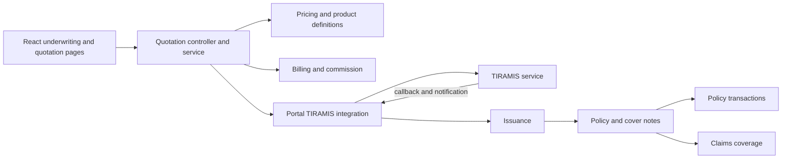
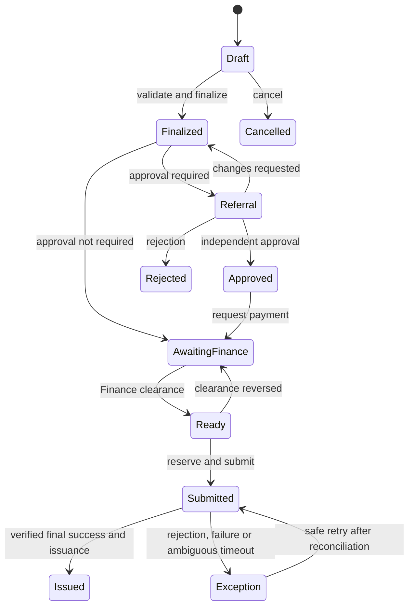

# Insurance Max underwriting design assessment

Status: working design, 6 November 2026. Static repository review only; no execution, production-data inspection, TIRA requests or specification verification. This is not yet the complete implementation-ready assessment requested: untraced paths and business decisions below are release blockers for detailed design. Paths below are relative to the repository root. Previous discovery was supplied in the request; a separate discovery report was not found in the inspected docs/reports inventory. Absence from a search is not proof of absence.

## 1. Executive assessment

The platform has substantial existing product versioning, pricing, quotation workflow, Finance, TIRAMIS, issuance, policy servicing, Claims and frontend modules. Keep the modular monolith and existing TIRAMIS service. The most urgent verified concern is a cash submission path that directly settles an invoice without creating a receipt in that method. A second high-priority concern is quotation status synchronization: acknowledgement can set legacy COMPLETED, while the rejection transition refuses COMPLETED. These require contained, tested corrections, not a rewrite. TIRA specifications and deployed configuration remain unverified; no assertions about regulatory requirements are made here.

## 2. Evidence and baseline changes

| Baseline | Static evidence | Assessment |
|---|---|---|
| Manual PAID through generic status | `quotations/quotations.service.ts:310`, `:6199` | Payment outcomes are now system-only on that endpoint. Other entry points require review. |
| Cash invoice paid without receipt | `quotations/quotations.service.ts:4583`, `:9950`, `:10067` | Submission calls cash settlement; method writes PAID and allocation totals without creating a receipt/allocation. Confirm production use. |
| Old event regresses PAID | `billing-commission/services/quotation-payment-event.service.ts:14` | Balance events now use current invoice status and check workflow revision. Other event types and race windows need tests. |
| Approval mainly discounts | `quotations/quotations.service.ts:8162` | Root approval calculation traverses discount approval flags; other workflows and authority controls require full mapping. |
| Quotation validity absent | `quotations/quotations.service.ts:2856`; `quotations/services/quotation-lifecycle.service.ts:874` | Correction to previous reply: draft `valid_until` maps to cover-note end date, not proven quotation offer validity. EXPIRED transition and pricing quote expiry exist; automatic offer expiry remains unverified. |
| Client commission | `quotations/quotations.service.ts:2894`; `billing-commission/services/commission-accrual.service.ts:44` | Draft accepts commission fields and accrual reads snapshot/cover note. Whether every final path validates against controlled rules remains unverified. |
| Motor hardcoding | `pricing/domain/motor-rating.config.ts:105`; `pricing/application/pricing-validation.service.ts:76` | Product-code and risk-name dependent logic exists. |
| Callback and issuance | `tenant/issuance/issuance.service.ts:80` | Issuance requires `regulatoryResponse.success` and a recognized final-success condition, and excludes policy transactions. Verify authentication, event ordering, and exact final-success semantics end to end. |
| COMPLETED on TIRA failure | `quotations/services/quotation-lifecycle.service.ts:789` | Confirmed when requirements are satisfied; TIRA status remains FAILED. Acknowledgement also sets COMPLETED at :633. |
| ACTIVE at issuance | `tenant/issuance/issuance.service.ts:499` | New policy is initialized ACTIVE and activated_at is issuance time; future-dated cover treatment needs business confirmation. |
| Short-period pro-rata | `policy-transactions/services/cancellation-pricing.service.ts:140` | Same day-count basis with separate configured charge; scale-table resolution is not established by this method. |
| Claims history | `claims/services/claim-coverage.service.ts:35` | Selects effective policy version and checks cancellation date. Snapshot shown contains version metadata; detailed historical terms require further trace. |
| Roles | `database/seeds/001-initial-rbac.seed.ts:4326` | UNDERWRITER exists; no Senior Underwriter/Underwriting Manager match in inspected seed search. Custom deployment roles unknown. |
| TIRAMIS security | `tiramis/src/modules/callbacks/services/tiramis-callback.service.ts:180`; `tiramis/src/modules/config/services/tiramis-config.service.ts:171` | Verification and tenant-context checks exist. Complete key, certificate, bypass and legacy-key audit remains open. Do not include secret material. |
| UI | `insurance-portal-web/src/modules/tenant/underwrite/nav.ts`; `quotations/pages` | Line-based underwriting navigation and both wizard and legacy quotation pages exist. Route reachability and stand-alone cover-note register remain unverified. |

Tax/levy support, full refund and reinsurance effects, all retry paths and customer/branch access are not yet revalidated.

## 3. Current architecture and capabilities



Arrows indicate observed module relationships or intended data flow; this is not a complete dependency graph. Quotation API has draft, finalize, approval, payment request, TIRA submit/retry and cancel commands in `quotations/quotations.controller.ts`. Product versions, definition items and add-ons live in `insurance-products/entities`; rate books in `pricing-rate-books`; risk, factor and rule modules are under `tenant/insurance-risks`, `rating-factors`, and `risk-rating-rules`. Confirm actual product selection, eligibility, channel restrictions, deductibles and document requirements by tracing their consumers before configuration changes.

| Capability | Observed implementation | Status / next design work | Priority |
|---|---|---|---|
| Product/risk and pricing | Product versions, rate books, pricing engine and motor-specific logic | Partial review; map class/subclass, rules, strategies and version selection | High |
| Customer/intermediary | Customer module; quotation has customer, intermediary and branch fields | Identity, duplicates, verification, snapshots and scopes untraced | High |
| Quotation | Lifecycle service, four legacy axes plus workflow axes, wizard and commands | Clarify synchronization, eligibility, revisions and expiry | Critical |
| Finance | Invoice, receipts, allocations, balance, projection and outbox services | Cash shortcut requires containment; transaction boundaries and reversals need full trace | Critical |
| TIRAMIS/issuance | Submission, callback, portal notification, issuance services | Verify final result, ordering, concurrency, retry and reconciliation | Critical |
| Policy servicing | PolicyTransaction, endorsement, cancellation and renewal services | Existing snapshots and gate axes; trace every apply and finance outcome | High |
| Claims | Date-of-loss version selection | Verify risk-specific historical terms and access scope | High |
| Registers and UX | Quotation/policy pages, line navigation, cover-note section | Confirm routes and APIs before adding views | Medium |
| Documents/reports | Document and reporting modules exist | Generation, versioning, security and metric definitions untraced | Medium |

## 4. Lifecycle and actions: proposed contract

Treat preparation, approval, payment and regulatory submission as separate axes. `COMPLETED` in the legacy status is not evidence of issuance. A derived display should use authoritative axes plus a linked issued record; do not rewrite history or silently reinterpret old values. Confirm mappings from all existing v1/v2 fields and reconcile inconsistent records before changing any contract.

| Current condition | Action / proposed permission | Validation | Result and failure |
|---|---|---|---|
| Draft | Save / create or update | Tenant, branch, ownership, basic schema and expected revision | Persist draft; conflict retains user's input |
| Draft | Calculate / update | Product and factors; server pricing | Versioned pricing result; show validation errors |
| Draft | Finalize / complete | Complete product-specific fields, current rate/version, pricing and cover dates | Freeze revision and snapshots; fail atomically |
| Finalized and referral required | Submit approval / submit-approval | Referral rules and revision | Pending referral; preserve reason |
| Pending | Approve, change request or reject / appropriate approval permission | Authority, scope, maker-checker, revision | Decision and audit; changed risk invalidates prior decision |
| Finalized and approved if needed | Request payment / request-payment | Valid invoice source, customer, currency, revision | Create/reuse invoice; no paid state inferred |
| Finance obligation | Post/allocate or reverse / Finance permission | Verified financial evidence and balance | Recalculate under lock, emit event; reconciliation on failure |
| Approved and cleared | Submit / submit-tiramis | Current revision, current Finance balance, eligibility, scope, no active submission | Reserve unique submission atomically; uncertain transport remains unresolved |
| Failed | Retry / retry-tiramis | Failure classified safe to retry; same business operation and confirmed TIRA semantics | New attempt linked to original; ambiguous timeout reconciled first |
| Draft or eligible pre-issuance | Cancel / cancel | No irreversible submission or unsettled obligations without resolution | Audited cancellation; otherwise exception workflow |
| Any visible record | View history / read | Tenant and branch scope | Immutable audit and status timeline |

Existing controller permissions must be checked against action-specific backend authorization and data scopes. Approval exemption in `quotation-lifecycle.service.ts:259` is an explicit policy decision requiring review; proposed normal operation disallows maker self-approval, including administrator bypass. A break-glass mechanism, if approved, must be independent, time-limited and audited and must not fabricate payment.



These are conceptual conditions, not a proposal to add all shown enum values. Quotation preparation completion is separate from final regulatory success and policy issuance.

## 5. Finance and regulatory design

Finance owns payment evidence, posting, allocations, refunds, write-offs and reconciliation. `invoice-balance.service.ts:17` locks and derives the balance from active allocations and paid refunds. Reuse it and `quotation-payment-event.service.ts`; a quotation payment field is a projection, not a second authority. At submission, atomically verify invoice identity, company, currency, quotation workflow revision, current balance and approved exception, with an appropriate lock or version check. If a reversal races submission, serialize locally and retain a durable regulatory exception if the external call has already begun. Never hold a database lock across external HTTP.

The cash shortcut at `quotations.service.ts:9950` should be contained after confirming operational dependencies. A Finance user posts a cash receipt, allocates it, recalculates the balance and commits an outbox event in the same transaction. Duplicate commands use scoped idempotency keys; consumers record event identity and derive the latest balance. Handle overpayments and refunds through Finance, with reconciliation queues. Credit, partial payment and exemptions are business options requiring explicit approved policy, limits, expiry and authorization, not implicit PAID flags.

Portal submission should reserve one business operation per tenant, source revision and transaction type under a unique constraint/lock, create an immutable attempt record and dispatch after commit. Store request, response and correlation identifiers without secrets. Verify signed callbacks, bind identity to tenant/environment and original request, deduplicate, apply final outcomes once, and retain unmatched/out-of-order messages for investigation. Acknowledgement is not issuance. Reconcile unknown delivery before any resend; classify rejection versus technical failure and apply retry limits only after current authoritative TIRA rules are verified. Test the observed `TIRAMIS_ACK_RECEIVED` -> COMPLETED -> `TIRAMIS_CALLBACK_REJECTED` sequence: `tiramis-integration.service.ts:1372` invokes these transitions, and `quotation-lifecycle.service.ts:749` refuses rejection on COMPLETED. This establishes a potential status inconsistency in these methods, not proof of the complete deployed event sequence.

Certificate exposure and legacy keys require an access-controlled inventory, exposure assessment and rotation plan; no certificate contents belong in the report. Verify that internal test signature bypass cannot be reached by external traffic. Confirm service principal tenant binding and HMAC replay protections across every route.

## 6. Pricing and product model

Use existing versioned product definitions and rate books; relate category -> class/subclass -> product version -> eligible risks -> required factors, limits, excesses, add-ons and rating rules. The exact current schema relationships remain to be mapped. Model motor constraints as explicit stable codes/configuration rather than inferred display names, preserving existing rate-book results during migration. Shared pipeline: validate eligibility and factors; select a versioned strategy; calculate base, minimums, loadings, discounts and benefits; calculate configured taxes/levies; sum and round using approved currency rules; snapshot inputs, rules, version, rounding and result hash. Product-specific strategies remain possible. Backend result is authoritative; UI previews must reconcile with it. Use decimal arithmetic throughout and define intermediate precision and rounding by currency with Finance; do not assume current precision is uniform.

Existing commission accrual reads quotation snapshot fields. Determine the authoritative rate source, effective dates, intermediary agreement, tax base and reversal timing with Finance. Confirm fixed, tiered or percentage levy requirements with Finance and applicable current rules before implementation. Preserve prior snapshots so changing a rate book never reprices historic cover.

## 7. Servicing and Claims

`PolicyTransaction` already stores source and proposed policy snapshots, version, approval/payment/submission axes, premium differences, idempotency key and state version (`policy-transactions/entities/policy-transaction.entity.ts`). Reuse this aggregate and transaction services.

- Endorsement: select policy/version, validate changes and effective date, price the difference, refer where required, create Finance adjustment, obtain applicable clearance, submit, and apply one new version only after final success. Retain previous versions and handle stale-version conflict by rebase/review. Refund or additional premium must follow Finance, not manual status editing.
- Cancellation: capture reason/date, claims review, configured method and approval; calculate earned and unearned premium separately from actual cash collected. Reconcile receivable, credit, refund, commission and reinsurance adjustments explicitly; no debt is erased by cancellation. Submit and apply once on confirmed outcome. `cancellation.service.ts:187` snapshots its pricing; its fallback at :660 uses policy premium fields, so a comment describing an amount as paid does not prove actual collection was consulted. The TPO approval exemption at :525 requires business review.
- Renewal: use existing renewal eligibility, offer and quotation factory with current rate/version, updated customer/risk, approval, payment and TIRA processing. Preserve policy linkage and prior terms. Define acceptance, expiry and lapse rules with business owners.
- Claims: use the version effective on loss date and cancellation effective time, with per-risk coverage, limits, deductibles and historical endorsements from immutable version snapshots. Existing `claim-coverage.service.ts` verifies version dates and cancellation but its shown snapshot does not establish full term evaluation. Confirm inclusivity/time zone, overlapping/backdated versions and access controls with Claims.

## 8. Roles, access and UX proposal

| Action | Underwriter | Senior | Manager | Administrator | Finance | Claims |
|---|---|---|---|---|---|---|
| Prepare/finalize/referral | Scoped | Scoped | Scoped | Only explicitly granted | — | — |
| Approve/reject | — | Delegated limit | Higher delegated limit | No automatic bypass | — | — |
| Request payment / view clearance | Scoped | Scoped | Scoped | Explicit grant | Finance workflow | — |
| Record/allocate/reverse payment | — | — | — | No automatic bypass | Authorized | — |
| Submit/retry TIRA | Scoped and eligible | Scoped and eligible | Scoped and eligible | Explicit grant, same gates | — | — |
| Policy read / servicing request | Scoped | Scoped | Scoped | Explicit grant | Financial view | Coverage read |
| Servicing approval | — | Delegated limit | Higher delegated limit | No automatic bypass | Finance decisions | Claims review where assigned |
| Reports/export | Scoped permission | Scoped | Scoped | Explicit grant | Financial scope | Claims scope |

These are proposed assignments, not present seed definitions. Configure authority by product/class, sum insured, premium, discount, risk, exception and effective delegation; no numeric limits are assumed. Audit actor, maker, decision, source revision, rule/version, reason, timestamp and delegation. Enforce company, branch and line scope server-side and mirror visibility in UI; test cross-tenant object identifiers and both list/detail routes.

Keep the existing Underwrite dashboard and line-based navigation. Add scoped filters and queues to existing quotation/policy screens before adding new pages. Proposed queues: drafts, referrals, payment pending, ready, regulatory exceptions, servicing and renewals. Source every dashboard count from authorized server queries, specify as-of time and date range, and do not present quoted premium as written premium.

```text
Underwriting | Line: Motor / Fleet / Non-motor | Branch | Date range
My drafts [count]  Referrals [count]  Payment pending [count]
Ready [count]      Regulatory exceptions [count]  Renewals [count]
Queue: owner | customer | product | premium | approval | finance | TIRA | next action
```

```text
Quotation: Customer > Product and cover > Risk details > Premium > Review
Existing customer [search]  New customer [inline]
Product-specific fields and validation
Server premium breakdown | rule/version | calculate again
Save draft | Back | Continue | Finalize
```

Use existing form/table/design tokens. Confirm whether standalone cover-note and submission registers already exist before adding views over existing records.

## 9. Documents, reporting and API impacts

Keep document versions linked to the quotation or policy transaction revision; generate draft quotation documents after calculation and final policy/cover-note documents only from authoritative issued records, subject to business approval. Verify existing template, PDF and authorization paths before proposing new ones. Regulatory acknowledgments should retain provenance and controlled access.

Reports must specify effective date, transaction date, currency, tenant/branch scope and source. Quoted premium comes from finalized quotation snapshots; written/issued premium from approved issued policy transactions according to agreed accounting definitions; collected/outstanding/refunded from Finance allocations, invoice balances and refunds; cancellation and endorsement movements from transaction records. Avoid adding unlike currencies or counting quotations as written business. No report is verified as implemented solely because a module exists.

Candidate design changes: extend existing quotation command/lifecycle and finance projection services; revise existing TIRAMIS integration and issuance handlers; use PolicyTransaction and PolicyVersion for servicing; expose scoped read projections for queues and loss-date coverage where current APIs are insufficient. Version any changed event/API contracts, retain old readers during migration and reconcile old status/financial records without deleting history. New tables or fields require a separately reviewed migration and rollback design; none is executed here.

## 10. Gap register

| ID | Gap and evidence | Risk | Priority / dependencies |
|---|---|---|---|
| UW-01 | Cash settlement `quotations.service.ts:9950` | Unsupported financial clearance | Critical; Finance cash process |
| UW-02 | Acknowledgment and rejection guards `quotation-lifecycle.service.ts:633,749` | Incorrect operational status | Critical; event ordering and TIRA semantics |
| UW-03 | COMPLETED on failed submission `quotation-lifecycle.service.ts:789` | False impression of issuance | High; legacy status compatibility |
| UW-04 | Discount-centric root referral `quotations.service.ts:8162` | Risks outside delegated authority | High; approved authority matrix |
| UW-05 | Motor name/code inference `motor-rating.config.ts:105` | Fragile rating | High; product mapping and historic parity |
| UW-06 | Short-period calculation `cancellation-pricing.service.ts:140` | Incorrect settlement if charge configuration is insufficient | High; approved cancellation tables |
| UW-07 | Claims snapshot `claim-coverage.service.ts:35` | Incomplete historical risk determination if no other path supplies it | High; Claims and policy snapshot trace |
| UW-08 | Client commission fields and accrual source | Uncontrolled commission if unvalidated | High; Finance rule trace |
| UW-09 | Signature, tenant, certificate and retry paths partly reviewed | Unauthorized submission or duplicate issuance | Critical; security and TIRA specification review |
| UW-10 | Offer validity not established | Expired offers may proceed | Medium; distinguish offer validity from cover dates and pricing expiry |

## 11. Scenario acceptance criteria

Current-state behavior is only asserted where evidence above supports it; each other scenario requires an end-to-end trace before implementation.

| Scenario | Proposed acceptance and failure handling |
|---|---|
| Standard motor | Server prices versioned risks; eligible, financially cleared submission produces one cover note/policy after verified final success; failure is visible and recoverable. |
| Fleet | Every vehicle is validated and snapshotted; duplicate request cannot mint duplicate notes; partial regulatory outcome requires explicit reconciliation. |
| Non-motor | Product-specific attributes and pricing are validated without motor assumptions; approval and Finance gates apply. |
| Discount referral | Outside delegated limit routes to independent authorized reviewer; rejection/change request preserves reason; changed price invalidates decision. |
| Payment pending | Invoice is outstanding and submit is blocked; only Finance can clear it. |
| Payment reversal | Before dispatch, revoke readiness; after dispatch/issuance, create exception and follow approved collection/coverage rules rather than silently voiding cover. |
| Rejection | Final rejection is preserved and displayed even after acknowledgement; no issuance. Test the current conflicting guards described in UW-02. |
| Timeout | Mark outcome unknown; reconcile with regulator before authorized retry; preserve each attempt. |
| Financial endorsement | Calculate difference, approve as required, Finance-clear debit, then apply one policy version after final regulatory success. |
| Partial collection cancellation | Separately calculate receivable, premium credit and eligible refund; no refund exceeds available authorized funds without approved Finance rules. |
| Renewal | Accepted offer uses current pricing and original-policy linkage; new cover begins under approved dates only after required gates. |
| Historical claim | Evaluate correct version and risk terms at loss date, including backdated changes and cancellation boundary; retain evidence. |
| Concurrent users | Revision checks reject stale edits; one active submission per business operation; duplicate callbacks produce one issuance. |
| Tenant/branch isolation | Lists, detail, mutation, export and callback cannot cross authorized scope; reject and audit. |
| Administrator override | Admin cannot fabricate payment or self-approve outside explicitly approved policy; all privileged actions audited. |

Each scenario still needs detailed current behavior, API permissions, record-level changes, fault injection and test fixtures; the table is a design acceptance outline rather than completed validation.

## 12. Phased roadmap and outstanding decisions

All phases require relevant scoped authorization tests, concurrency/idempotency tests, audit checks and rollback that preserves financial and regulatory records. No calendar estimate is asserted.

| Phase | Objective and reuse | Main impact / dependency | Acceptance and rollback | Complexity |
|---|---|---|---|---|
| UW-0 | Contain cash and security risks using Finance and existing guards | Backend/config; operational Finance and security review | No unsupported paid state; security checks; feature containment with reconciliation, no financial deletion | High |
| UW-1 | Authority and roles using existing RBAC/lifecycle | Backend, role configuration, UI; approved limits | Independent approvals and scope tests; revert assignments without erasing decisions | Medium-high |
| UW-2 | Consistent quotation status and offer validity | Lifecycle, projections, UI; legacy data mapping | Ack/fail/reject and expiration tests; retain old fields and reversible readers | High |
| UW-3 | Versioned rating and motor configuration | Existing product/pricing, possible schema/UI | Historic parity and rounding tests; keep prior versions and fallback | High |
| UW-4 | Finance clearance and reliable TIRAMIS | Invoice/receipt, outbox, submission, webhook; TIRA specification | Reversal, duplicate, timeout and reconciliation tests; stop dispatch safely, retain attempts | High |
| UW-5 | Servicing and historical coverage | PolicyTransaction, versions, Claims and Finance | Endorsement/cancellation/renewal loss-date tests; compensate rather than delete applied transactions | High |
| UW-6 | Scoped queues and registers | Existing UI and read APIs | Counts reconcile with records; feature flag and revert UI | Medium |
| UW-7 | Reports and readiness | Reporting/documents and all preceding phases | Source-to-report reconciliation, restore and operational exercises; disable reports without altering source | High |

Before implementation confirm: authority thresholds and delegation; partial, cash, broker/corporate credit and exemption rules; commission source and reversals; cancellation scale, taxes, debt and refunds; effective-time and future activation policy; product-specific factors; renewal notice/lapse; TIRA acknowledgment, identifiers and retry rules; Finance/Claims/Underwriting boundaries. Capture options and implications with owners rather than assigning unsupported values.

After urgent containment, the recommended independent first development task is Finance-authoritative clearance for the existing quotation revision, using invoice balance and allocation evidence. Protect it with tests for cash, partial/full/overpayment, reversals, stale outbox events, duplicate commands, cross-tenant access and concurrent submission. This recommendation must be revisited after the remaining transaction-boundary and deployed-configuration review.

## 13. Work still required before calling this report complete

Trace all fifteen scenarios through controller, authorization, service, entity, event and UI; inventory product/customer/document/report behavior; review all seventeen baseline findings and actual frontend routes; audit regulatory credentials and retry paths without disclosing secrets; verify TIRA specifications with authoritative sources; provide complete current/future workflow diagrams, action and permission matrices, detailed event/API schema, migration/rollback, source-based metrics, decision options and phase-specific tests. Run relevant tests only when authorized and safe; this review did not execute them. Business owners must approve rules, and the completed design should be reviewed before implementation.

# Investigation continuation — 6 November 2026

## Review basis and classifications

**Verified** means a static observation in the working tree, not an assertion that code is deployed or that an end-to-end test passed. **Inferred** means a risk inferred from code requiring a reproducible test. **Proposed** denotes design, not current behavior. **Unverified** denotes untraced behavior, deployment settings or a decision. The working tree already contained changes in quotation and Finance code, including the event handler, and staged removals of certificate files; findings apply to that working tree. No inference is made about the contents of certificates, whether they were real, current deployment exposure, or repository history. Do not restore, inspect or disclose credentials as part of this assessment.

The earlier statement that `valid_until` demonstrated quotation-offer validity is corrected in section 2. **Verified:** renewal offers have their own `offer_expires_at` and `accept` rejects an expired sent offer (`policy-transactions/services/renewal.service.ts:440-480`). This is distinct from general new-business quotation expiry.

## Critical issue designs

### UW-01 Cash settlement

**Verified root cause and path:** `QuotationsService.submit` calls `prepareTrustedTiraSubmission` before `startTiraSubmission`; the former calls `ensureCashInvoiceSettledForSubmission` (`quotations/quotations.service.ts:1982, 4570, 9950`). `settleCashQuotationInvoice` sets invoice paid and allocated fields directly and saves it, then marks the quotation paid. That method does not create a receipt, receipt allocation or Finance journal. Recalculation by `InvoiceBalanceService.recalculate` instead sums active allocations and paid refunds under an invoice write lock (`billing-commission/services/invoice-balance.service.ts:17`).

**Verified existing alternative:** `finance.controller.ts:140,167,176,186,196` exposes manual payment, receipt posting, allocation and reversals with separate Finance permissions; `FinanceCommandService.postReceipt` (`finance-command.service.ts:362`) requires a successful payment transaction and returns an existing posted receipt for the same payment. Allocation and balance projections exist. Legacy `tenant/billing` CRUD endpoints also exist and need a separate guard/write-path audit; their existence does not establish safe Finance ownership.

**Proposed:** remove or feature-gate the shortcut only after approved operational containment; underwriting requests an invoice and Finance records a verified cash payment, posts a receipt and allocates it. Use an explicit clearing gate that reads the Finance invoice, revision, currency, amount and allowed exception, without a second independently editable ledger. Record idempotency keys and audit actor/evidence. **Impact:** existing API payment request may stay stable; UI shows Finance status and handoff; possible schema only if existing event/version keys cannot provide atomicity. **Compatibility:** identify historical shortcut-paid invoices by reconciliation, never invent receipts retroactively; Finance investigates or posts authorized corrections. **Tests:** no receipt means no clearance; manual payment/receipt/allocation; duplicate commands; scope; rollback on journal failure; pre-existing paid invoice reconciliation; concurrent submit/reversal. **Rollback:** disable new dispatch and restore compatible read behavior; preserve financial records and investigate exceptions instead of re-enabling unsupported clearance. No code or data change is authorized by this report.

### UW-02/UW-03 Acknowledgment, rejection and COMPLETED

**Verified:** `tiramis-integration.service.ts:1372-1427` maps ACK_RECEIVED with code TIRA001 to `markTiraAcknowledged`, callback-rejected to `markTiraRejected`, failed events to `markTiraFailed`, and overdue callback to acknowledged. `quotation-lifecycle.service.ts:633` sets legacy status COMPLETED and TIRA SUBMITTED on acknowledgement; `:749` refuses rejection if status is COMPLETED; `:789` assigns COMPLETED on failure when approval/payment requirements are satisfied. `markTiraProcessing` also ignores COMPLETED (`:586`). **Inferred:** those methods in this event order can leave quotation status inconsistent with a later rejection, unless another path changes it; reproduce with actual callback routing and inspect whether the event name signifies regulatory business rejection or callback rejection. Do not equate the two without the TIRA contract. Failure itself is visibly represented by TIRA FAILED despite legacy COMPLETED.

**Proposed:** use TIRA outcome and issued records for operational display and allow a verified final rejection after acknowledgement, with terminal precedence tied to the relevant attempt and protected against late, superseded attempts. Preserve legacy fields/consumers during migration, document their existing meaning, and reconcile historical discrepancies separately. **API/database:** preferably derived status plus existing history; add durable attempt correlation or revision if existing records do not establish it. **Tests:** ack -> processing -> final rejection; ack -> success; failure; duplicate and out-of-order events; old-attempt success after retry; no policy on rejected response; legacy clients. **Rollback:** feature-flag projection/transition behavior, retain raw events and status history; never reverse an issued policy solely by rolling back UI code.

### UW-04 Financial consistency and concurrency

**Verified:** `QuotationLifecycleService.withLockedQuotation` locks a quotation per transition (`quotation-lifecycle.service.ts:1103`), and `InvoiceBalanceService` locks the invoice during recalculation. `QuotationPaymentEventService.apply` looks up the current invoice for balance events and rejects a different workflow revision; failure/refund events take separate branches. The working-tree event service is modified. Locks on separate operations do not by themselves prove a shared atomic clearance-to-dispatch transaction.

**Proposed:** use a consistent lock order for quotation and invoice, validate current source revision, status and balance, and atomically reserve a submission intent before network dispatch. In the same local transaction record relevant finance balance revision and workflow revision. Once dispatch begins, a reversal generates an exception/reconciliation event rather than pretending it prevented delivery. Outbox and event consumers must be idempotent and re-read current source, with dead-letter visibility and a reconciliation job. **API/schema:** add version token/intent only if existing fields and unique keys do not suffice; reject stale requests without breaking old read clients. **Tests:** allocation and reversal racing dispatch; old balance and refund/failure events; outbox redelivery; crash between commit and send; no duplicate invoice and no lost reversal. **Rollback:** stop new dispatch, drain or quarantine intents, retain event records, reconcile projections to invoice ledger.

### UW-05 Retry and duplicate prevention

**Verified:** quotation submit turns a FAILED TIRA status into force resubmit (`quotations.service.ts:1982-2055`); `TiramisIntegrationService` creates a new portal submission and request ID for each outbound attempt (`tiramis-integration.service.ts:118-170`), and catches errors as FAILED (`:225`). The retry scheduler has a configurable enable check encompassing both retry delivery and missing-callback detection (`tiramis/src/modules/submissions/services/tiramis-retry-scheduler.service.ts:52-76`), and its manual method creates a retry attempt (`:105`). `Policy` defines a unique company/quotation/source-revision index (`policies/entities/policy.entity.ts:44`); this helps prevent duplicate policy rows but does not prove no duplicate regulatory cover notes. Portal submission indexes shown in `portal-tira-submission.entity.ts:21-27` are ordinary indexes. Other service-level locks/constraints need complete inspection.

**Inferred:** a caught network timeout can represent unknown remote delivery yet become eligible for resubmission, and changing request IDs may increase duplicate risk unless TIRA supports the chosen semantics. **Proposed:** distinguish known-not-sent, confirmed rejection, unknown delivery and confirmed success; reconcile unknown delivery using approved regulator inquiry/manual procedure before a new attempt. Use one tenant/source/revision/business-operation reservation and immutable attempts; enforce unique live intent at the database after duplicate-data assessment. Define original/new request-ID policy only after TIRA confirmation. Separate monitoring from retry-enable configuration. **Tests:** two concurrent submits, timeout before/after remote receipt, late old callback, retry collisions, callback duplication and worker restarts. **Rollback:** disable dispatch/retry independently, preserve and reconcile attempts; never delete regulatory history. **External dependency:** official integration specification was not found in the public sources reviewed; no message format or retry requirement is asserted.

### UW-06 Authority and administrator bypass

**Verified:** `quotation-lifecycle.service.ts:259` prohibits approval by the approval submitter unless `approvals:self-approve`; `maker-checker.ts` and quotation/cancellation/endorsement callers pass that exemption. Seed assignments exist for the exemption (`database/seeds/001-initial-rbac.seed.ts:3140,3600,3757`); exact active role membership is deployment-specific. Root quotation approval is based on discount approval flags (`quotations.service.ts:8162`); cancellation includes a third-party-only approval exemption (`cancellation.service.ts:525`). Scope assertions are used for quotation write (`quotations.service.ts:377-400`). These checks alone do not establish full separation from the author of a quotation or absence of an admin bypass on all endpoints.

**Proposed:** management signs off role/line/branch authority and referral matrix without invented amounts; approval verifies original maker and any material editor against approver, effective delegated limits, rule version and current revision. No blanket admin self-approval or payment bypass; any approved emergency procedure requires separate independent approval and a durable audit. Review all existing exemption assignments and alternate endpoints. **Tests:** creator differs from submitter but tries to approve; admin exemption; delegated limit boundaries; expired delegation; branch and tenant isolation; stale version. **Compatibility/rollback:** leave existing roles intact until reviewed mapping and dual-read are ready; remove grants only through an approved operational rollout; preserve historical approvals.

### UW-07 Credentials, tenant binding and webhook security

**Verified:** TIRAMIS key guard resolves tenant binding and rejects mismatches for populated bound values (`tiramis-api-key.guard.ts:190-240`); legacy raw-key validation is controlled by configuration (`tiramis-api-key.service.ts:252`). Callback signature verification exists (`tiramis-callback.service.ts:180`) with an internal bypass path whose reachability must be assessed. Portal webhook requires API-key scope, verifies signature, then claims a receipt and rejects a duplicate event key with a different payload hash (`tiramis-integration-webhook.controller.ts:25-140`). Portal HMAC verifier checks timestamp, hash, nonce and signature, then reserves the nonce in Redis (`services/tiramis-webhook-signature.service.ts:18-45`). **Inferred:** separate nonce existence check and reservation may permit concurrent replay; event receipt deduplication is an additional layer, not proof the nonce is atomically claimed. Verify Redis semantics, tenant scoping, failure/replay recovery and API-key scope configuration.

**Proposed:** security team inventories exposure and rotates affected material if warranted; move any private keys out of tracked/deployed artifacts, ensure narrowly scoped tenant-bound keys, phase out legacy keys after client migration, enforce signature verification in production, atomically reserve nonce after authentication, bind event to original tenant and request, and retain audited failed receipts. **Tests:** cross-tenant principal/context mismatch; replay race; invalid/expired signature; bypass denied; old/new key rotation; duplicate payload mismatch; unavailable Redis and callback recovery. **Impact/rollback:** operational key rotation and possibly nonce storage changes; staged dual-key verification for bounded migration, then retire old key. Never roll back to exposed material. Exact deployments, secret history and regulatory certificate requirements remain unverified.

## Current workflow evidence and integration paths

**Verified UI routes:** `insurance-portal-web/src/modules/tenant/underwrite/routes.tsx:142-326,429-582` provides line-scoped quotations, policies, customers, renewals, endorsements, cancellations, TIRA pending/failed and motor/fleet/non-motor wizard routes. `underwrite/paths.ts` defines their paths. UI gates include line/action and legacy permissions; backend checks remain authoritative. `underwrite/underwrite-quotations.controller.ts:54-121` has line-scoped draft, edit, finalize and delete actions; central `quotations/quotations.controller.ts` supplies workflow and submission actions. Fleet/non-motor detail payload mapping and every wizard step are **unverified end-to-end**.

**Verified Finance:** `finance.controller.ts` supplies separate receipt, allocation, reversal, refund and reconciliation commands. `finance-command.service.ts:362-465,613-742` shows successful-payment-to-receipt posting, balance recalculation and reversals. `quotation-payment-projection.service.ts` creates finance outbox events and projects balance. Exact permission constants, all posting transaction boundaries and worker failure handling need a complete review.

**Verified issuance:** `tiramis-integration.service.ts:490-620` persists notification state, updates quotation, calls issuance, tries renewal linkage and then policy/transaction updates. The calls are not shown as one encompassing transaction, so recovery after partial processing must be tested. `issuance/issuance.service.ts:80-155` requires a successful regulatory response and recognized final event, and excludes policy-transaction sources. `policies/entities/policy.entity.ts:44` declares unique quotation/revision policy issuance. Renewal linkage exceptions are logged and swallowed in the notification handler; audit and repair of failed linkage require verification.

**Verified servicing:** endorsement endpoints include create, changes, recalculate, complete, approval, payment, submission, retry and reconciliation (`policy-transactions/controllers/endorsements.controller.ts:60-322`). Cancellation endpoints include eligibility, create, claims review, approval, payment and submission (`controllers/cancellations.controller.ts:47-258`). `PolicyTransactionRegulatoryOutcomeService.captureFinalSuccess` locks the transaction and requires response.success (`services/policy-transaction-regulatory-outcome.service.ts:35`), with additional replacement-reference checks. Exact full apply, finance and claims paths remain **unverified**. Renewal accept and issued-policy linkage are observed in `renewal.service.ts:452,528`; linkage reuses normal issuance and locks the renewal. Successful issuance followed by failed renewal linking needs operational recovery.

**Verified registers:** `cover-notes/cover-notes.controller.ts:26-61` exposes list, detail and an issuance endpoint; `cover-notes/components/CoverNotesSection.tsx` exists. Whether a standalone routed register exists and whether the issuance endpoint has all appropriate final-response controls are **unverified**. TIRA queue routes already exist; avoid duplicating them.

```mermaid
sequenceDiagram
 participant U as Underwriter
 participant Q as Quotation service
 participant F as Finance
 participant P as Portal TIRAMIS
 participant T as TIRAMIS
 participant I as Issuance
 U->>Q: Finalize, refer if required, request payment
 Q->>F: Create or reuse invoice
 F->>F: Record payment; post receipt; allocate
 F-->>Q: Balance projection / outbox
 U->>Q: Submit eligible revision
 Q->>P: Submit business record
 P->>T: Request and acknowledgment
 T-->>P: Authenticated final notification
 P->>Q: Apply outcome
 P->>I: Issue on qualifying final success
```

Diagram mixes existing components with the **proposed** receipt-based cash path; the present cash shortcut is explicitly different. Exact network boundaries and all handlers require further tracing.

## Regulatory source check

TIRA's [public TIRAMIS portal](https://tiramis.tira.go.tz/) provides cover-note verification by several identifiers. TIRA also publishes [revised premium levy guidelines, November 2025](https://tira.go.tz/uploads/documents/sw-1764074358-GUIDELINES%20FOR%20PREMIUM%20LEVY%20COMPUTATION%20AND%20COLLECTION%20%28Revised%20Version%20No.%2002%20of%20November%202025%29.pdf). These sources do not establish the API message formats, acknowledgement semantics, idempotency or retry rules. Obtain the insurer's current authoritative integration specification and confirm applicability and levy treatment with Finance and Compliance; do not derive customer charges automatically from a levy guideline without that assessment.

## Implementation decision gates

1. Finance: approve cash evidence and posting process, partial/credit/exemption eligibility, reversals and historical cash-settlement reconciliation.
2. Underwriting management: approve role limits, referrals, independent approvals, delegated authority and cancellation exceptions.
3. TIRA integration owner/Compliance: obtain current specification and decide request identity, timeout reconciliation, callback meanings and certificate/key controls.
4. Claims and underwriting: approve version effective-date boundaries, backdated changes and loss-date risk/limit/excess selection.
5. Architecture/operations: approve lock order, intent/outbox recovery and migration plan after full path and deployment review.

## Remaining completion blockers

The assessment is **not implementation-ready**. The request requires actual current behavior, APIs, permissions, database changes, events, failures and automated tests for all 15 scenarios; current evidence does not yet trace each end to end. Missing work includes complete motor/fleet/non-motor wizard-to-payload and pricing paths; customer identity/duplicate and product eligibility; legacy Finance CRUD guard and event workers; precise TIRAMIS business submission/worker locks and retries; all policy transaction apply/refund/commission/reinsurance and Claims risk-term paths; document/report source definitions; cross-tenant/branch checks for every endpoint; and deployment-specific security settings. The 15-scenario table above is an acceptance outline, not a verified scenario matrix. Business decisions and official interface specifications also remain open. Continue analysis before final approval of implementation prompts.
